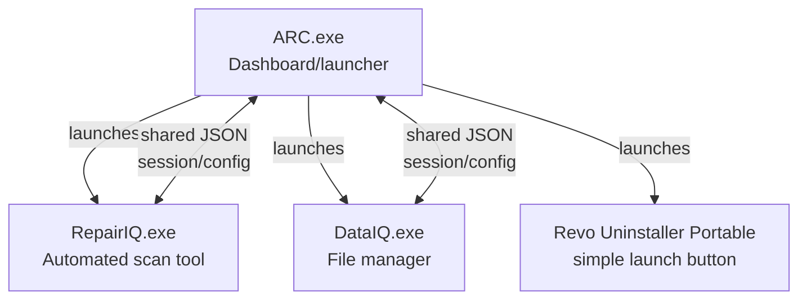
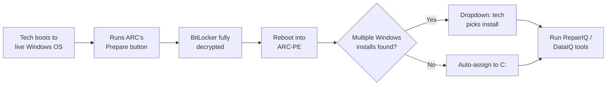

# ARC (Advanced Repair Console) — Capstone Technical Plan

2026-09-20 · @Someone

## Overview

ARC (Advanced Repair Console) is a solo SNHU capstone project: a custom Windows-based bootable diagnostic and repair toolkit for computer repair technicians. It replaces an earlier Ventoy-based concept, dropped over licensing concerns, with a WinPE boot backend (boot mode name: ARC-PE).

The capstone runs 8 weeks, solo work with professor (Prof. Lusby) input. ARC is designed to work either logged into a customer's live Windows OS, or booted externally via ARC-PE, and targets any x64 computer. Long-term, the goal is a portable tool to use personally, share with coworkers, and potentially offer to repair shops.

## Capstone rubric mapping

The SNHU capstone rubric has three enhancement categories, each requiring an existing artifact with explained origin, an enhancement plan (pseudocode/flowchart), and an explanation of how it demonstrates skills/course outcomes. ARC is being used as the **single artifact across all three categories**:

| Category | How ARC applies |
| --- | --- |
| Software Engineering & Design | ARC's multi-process architecture (ARC.exe + RepairIQ + DataIQ), UI/UX design, and modular boot-mode handling |
| Algorithms & Data Structures | RepairIQ's automated diagnostic sequence (hardware tests, AV, corruption checks) and its decision/scoring logic |
| Databases | The shared JSON session/config file used to pass state (drive letter, mode, hostname, etc.) between ARC.exe and its module processes, plus scan report storage |

The capstone also requires an **ePortfolio Overall Skill Set** section, covering three components: a code review, the enhancement narratives for the three categories above, and a professional self-assessment.

## Naming and branding

| Term | Meaning |
| --- | --- |
| ARC | Advanced Repair Console — the overall project/product name |
| ARC-PE | The WinPE-based boot mode used to run ARC externally |
| RepairIQ | The automated one-click scan/diagnostic module |
| DataIQ | The file manager module for data transfers/imaging |

Visual design uses ARC's own clean, light theme: a white workspace with an indigo-violet (#5E44C7) primary color for actions and the device-info sidebar, defined once in `arc/SharedUI/ArcTheme.xaml` and shared by all three apps. Each tool in the dashboard UI will have a short description so technicians aren't confused about what it does.

## System architecture

ARC is split into three separate, independently launched .exe processes rather than one monolithic app, for better encapsulation:

Key decisions:

- ARC.exe is the only process that shows the persistent system info panel (detected Windows install, drive, hostname) — RepairIQ and DataIQ open as separate windows, so the tech can always return to the ARC dashboard.
- RepairIQ and DataIQ are separate processes (not windows within one process) to simplify development and isolate failures.
- A Revo Uninstaller Portable (Free, unmodified) launcher button is included for the live-OS version — no deep integration, just a button labeled "Uninstaller."

## Boot modes and workflow

ARC supports two modes, with ARC-PE expected to be the primary/most-used one, but the same tools remain accessible from the live OS (including BitLocker-disable):

- This flow avoids needing to touch boot order or BIOS settings.
- ARC-PE runs on the default WinPE X: drive; drive lettering otherwise is unimportant.
- ARC-PE auto-detects the Windows installation on the host drive and assigns it to C: for ARC's tools.
- If no Windows installation is detected (encrypted or corrupt drive), this is handled by technician training, not in-app error messaging.
- If more than one Windows installation is found, the boot sequence shows a dropdown for the tech to choose — not fully automatic single-selection.

## BitLocker prepare/decrypt flow

The "Prepare" step is a deliberate, simple design choice:

- **Full decryption, not suspension.** BitLocker is always fully decrypted (never just suspended) to avoid rework from BitLocker-related issues later in the repair.
- **No re-encryption after repair.** Re-encrypting the drive post-repair is explicitly out of scope for now.
- **Live progress feedback.** The Prepare step shows a live decryption percentage on screen so the tech knows the process is actually running (BitLocker decryption can take a while with no other feedback).

## RepairIQ (scan module)

RepairIQ is ARC's core automated diagnostic tool:

- **Hardware tests:** CPU, RAM, SMART (drive health)
- **Antivirus scan**
- **OS/registry corruption checks**
- **File integrity checks** (file replication/verification)

Operating characteristics:

- Auto-detects hardware present on the machine
- Unattended, one-click run — no step-by-step tech interaction required once started
- Verbose logging throughout the run
- Report saved directly to the flash drive itself (not just displayed on screen)

A possible future integration: an existing third-party hardware-diagnostics command-line tool that RepairIQ could wrap or call into, rather than reimplementing all hardware tests from scratch.

## DataIQ (file manager module)

DataIQ is ARC's file manager, used primarily for data transfers and imaging. Like RepairIQ, it launches as its own separate .exe process from the ARC dashboard, so the tech can keep the main ARC window available while it's open.

## Dashboard/launcher UI

ARC.exe is the main dashboard/launcher, built on Uno Platform (targeting `net10.0-desktop` via its Skia renderer) rather than plain WPF — chosen so the UI can be built and run directly on the Linux dev machine during development, not only on Windows. Layout has no strict requirement — the design will adapt to whatever the framework handles well by default, rather than forcing a specific look. The one fixed requirement: a visible system info panel is always shown on the ARC.exe dashboard (detected Windows install, drive, hostname), giving the tech a persistent reference point they can return to after opening RepairIQ or DataIQ.

Each launchable tool (RepairIQ, DataIQ, Uninstaller) should have a short on-screen description so technicians aren't confused about what it does before clicking it.

## Inter-process communication

Because ARC.exe, RepairIQ, and DataIQ are separate processes, they need a way to share context. The decision: a **shared JSON session/config file** on disk, written by ARC.exe and read by the module processes, carrying:

- Drive letter (e.g., which drive is C: in ARC-PE)
- Current mode (live OS vs. ARC-PE)
- Hostname
- Other session context as needed

JSON was chosen specifically because it's human-readable, which matters for debugging and for reviewing session state later (e.g., after a repair, or while writing up the capstone's database-enhancement narrative).

## Open questions and next steps

Decided, not yet built (based on discussion so far):

- [ ] Pick the concrete WinPE build tooling (e.g., Windows ADK-based WinPE customization) and confirm it can host the Uno Platform-based launcher
- [ ] Confirm which BitLocker API/CLI approach (manage-bde, PowerShell BitLocker cmdlets) will run the full decrypt with a progress readout
- [ ] Define the exact JSON schema for the shared session/config file
- [ ] Scope RepairIQ's hardware test implementation — build from scratch vs. wrap an existing third-party diagnostics CLI (needs confirming access/licensing)
- [ ] Design the multi-Windows-install detection and dropdown UI in the ARC-PE boot sequence
- [ ] Map each capstone milestone/week to a specific ARC deliverable (code review artifact, enhancement narratives, self-assessment)

These are natural next planning or build sessions.
